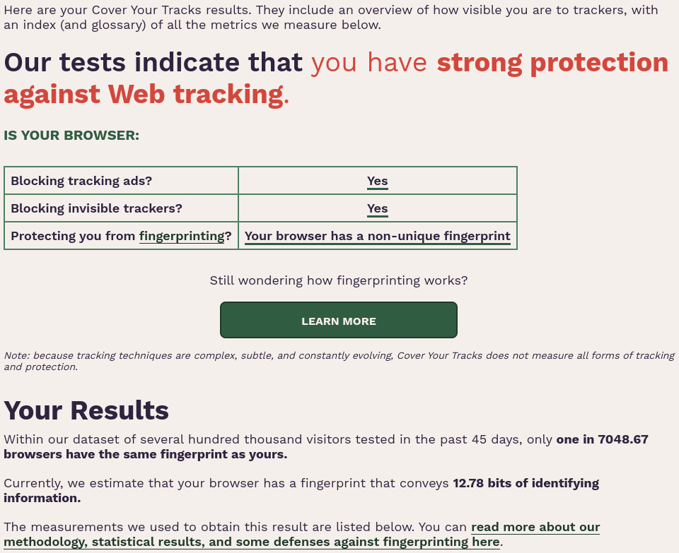

## ⛔ Important Note!
This project that's available on [GitHub](https://github.com/A7md70242602GH/AdvancedFox) is for improving the visibility, the main repository for downloading and using the policies.json and user.js files are available on [GitLab](https://gitlab.com/iahmed_7024-group/advancedfox).

# AdvancedFox

## Overview
**AdvancedFox** is a project that's free and open source and it provides some policies.json and user.js files for blocking ads, trackers, resisting fingerprint and cookies, disabling Mozilla telemetry, disabling AI features and improving browser's performance.

## ⚔️ All policies and user.js types
Files/Levels | 📄 policies (Privacy & Security) | 📜 user.js (Privacy & Security)
-|-|-
**💪🏻 Strong** | ✅ _Sets SearXNG as the default search engine, and installs uBlock Origin and NoScript by default._ | ✅ _Blocks ads and trackers and resists fingerprinting by default._
**🛡️ Medium** | ✅ _Sets SearXNG as the default search engine, and installs uBlock Origin by default._ | ✅ _Blocks ads and trackers and resists fingerprinting by default._
**🗡️ Weak** | ✅ _Sets SearXNG as the default search engine by default._ | ✅ _Blocks ads and trackers by default._

### ⚙️ Other policies and user.js types
1. **Disable AI Features.**
2. **Disable Mozilla Telemetry.**
3. **Performance.**
4. **Resisting Cookies**

## ✨ Features
- [x] **_Blocking ads by default._**
- [x] **_Blocking trackers by default._**
- [x] **_Resisting fingerprinting._**
- [x] **_Linux and Windows support._**
- [x] **_Free and open source project._**
- [x] **_Able to choose how much privacy protection you want._**
- [x] **_Better performance._**
- [ ] _Able to choose how much performance level you want._
- [x] **_Setting SearXNG as the default search engine._**
- [x] **_Installing uBlock Origin by default._**
- [x] **_Disabling Mozilla telemetry._**
- [x] **_Disabling AI Features._**
- [x] **_Resisting Cookies._**

**After installing the policies.json (Privacy & Security) and user.js (Privacy & Security) files with strong level, this is the result in one of the best websites for testing web tracking (click [here](https://gitlab.com/iahmed_7024-group/advancedfox/-/blob/main/Privacy%20&%20Security/Firefox%20ESR%20153/EFF-CYT_data.txt) to see detailed EFF data):**

Note: You may not get this result, it's different between each device and each system.

## 🚫 Fingerprinting Problems In Firefox ESR 153

**There are 3 things that may prevent your browser fingerprint from being non-unique**:

| Objects | Reasons |
|---------|---------|
| **Fonts** (Linux only) | _A structural restriction in Linux support for_ `font-visibility`_._ |
| **Touch Support** | _The option_ `privacy.resistFingerprinting` _sets Max touchpoints value to 5 on every device, and this value is uniquer than 0._ |
| **User Agent** | _Firefox ESR 153 users is low for now, because most of Firefox ESR users is on Firefox ESR 140, and because the best browser in resesting fingerprint is on Firefox ESR 140, the browser that I'm talking about is_ **Tor Web Browser** _._ |

**These things can't be resolved by a policies.json or user.js files, the resolve key is in Mozilla's hand (except user agent problem).**

**Note:** You can fix two of the three problems with some modifications on your system, and some extentions on your browser, maybe there is upcoming guide to do these solutions.

If these issues resolved, Firefox with the policies.json and user.js files will show you this result on Cover Your Tracks test: "**Your browser has a non-unique fingerprint.**".

## 📥 Installation

#### 📄 policies.json
1. Go to "[AFDC](https://gitlab.com/iahmed_7024-group/advancedfox/-/wikis/AFDC)".
2. In "Privacy & Security" section, choose the privacy level that you want to use.
3. Click on "policies.json" with the level that you chose.
4. Once it's downloaded, rename it to `policies.json` and then copy it.
5. Putting the file in the right position:

###### Linux:
**Official Build**: Go to the installation directory (it may be in `/opt/firefox/`), then go to `distribution` folder (create it if not available) and paste the file there.

**Package Manager**: Go to `/usr/lib/firefox/`, then go to `distribution` folder (create it if not available) and paste the file there.

**Commands** (you have to run it with privilege permissions):
1. `mkdir /opt/firefox-esr/distribution/ && mv <policies.json file location> /opt/firefox-esr/distribution/`.
2. `mkdir /usr/lib/firefox/distribution/ && mv <policies.json file location> /usr/lib/firefox/distribution/`.

###### Windows:
Go to `C:\Program Files\Mozilla Firefox\`, then go to `distribution` folder (create it if not available) and paste the file there.

6. Restart Firefox to apply changes.

#### 📜 user.js
1. Go to "[AFDC](https://gitlab.com/iahmed_7024-group/advancedfox/-/wikis/AFDC)".
2. In "Privacy & Security" section, choose your operating system.
3. Choose the privacy level that you want to use.
4. Click on the user.js file with the level that you chose.
5. Once it's downloaded, rename it to `user.js` and then copy it.
6. Open Firefox.
7. Type in the search bar: `about:profiles`.
8. Choose the profile that you want to add the user.js into it and then click on `Open Directory` in `Root Directory` section.
9. Backup your `prefs.js` file by copying and pasting it in the same location with `prefs.js.bkup` name.
10. Paste the user.js.
11. Restart Firefox to apply changes.

## 🛑 Deletion

#### 📄 policies.json
1. Remove the file:

###### Linux:
**Official Build**: Go to the installation directory (it may be in `/opt/firefox/`), then go to `distribution` folder and then remove the file.

**Package Manager**: Go to `/usr/lib/firefox/`, then go to `distribution` folder and then remove the file.

**Commands** (you have to run it with privilege permissions):
1. `rm /opt/firefox-esr/distribution/policies.json `.
2. `rm /usr/lib/firefox/distribution/policies.json `.

###### Windows:
Go to `C:\Program Files\Mozilla Firefox\`, then go to `distribution` folder and then remove the file.

2. Restart Firefox to apply changes.

#### 📜 user.js
1. Open Firefox.
2. Type in the search bar: `about:profiles`.
3. Choose the profile that you added the user.js into it and then click on `Open Directory` in `Root Directory` section.
4. Remove the `user.js` and `prefs.js` files.
5. Rename the `prefs.js.bkup` to `prefs.js`.
6. Restart Firefox to apply changes.

## 🪪 License
This project is licensed under [MIT License](https://mit-license.org/).

## ©️ Credits
- **A7** ([GitLab](https://gitlab.com/iAhmed_7024) - [GitHub](https://github.com/A7md70242602GH))
- **SHIMORA** ([GitLab](https://gitlab.com/SHIMORA_6600X) - [GitHub](https://github.com/SHIMORA-6600X))

Project Version: **1.0.4_4**.